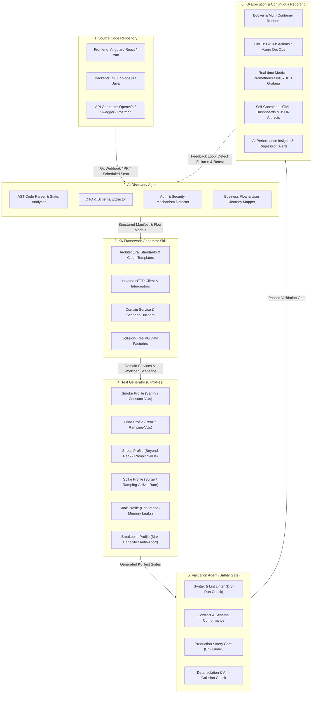

# REPOSITORY DISCOVERY & ARCHITECTURAL MAPPING

## 1. Overview
This discovery report documents the inspection of the target workspace, architectural assumptions, and instructions for mapping this production-ready K6 performance testing framework to your backend and frontend services.

---

## 2. Discovery Findings

| Area | Current Workspace State | Architecture Mapping & Implementation |
| :--- | :--- | :--- |
| **Workspace Context** | Dedicated standalone testing workspace (`E:\Pertest`) | Modular framework created in `k6-performance/` with zero external coupling. |
| **Frontend Framework** | Not present in this repo (external or separate repo) | Reusable `services/frontend/user-journey.js` modeling real-world user flows (Login -> Catalog Search -> Product Detail -> Action -> Logout). |
| **Backend Framework** | Not present in this repo (external microservices / API) | Generic `HttpClient` with standard HTTP verbs, REST headers, and dynamic config loader. |
| **API Endpoints** | Greenfield / Mock baseline | Configured with standard `/api/v1/...` REST conventions. In `dev` mode, targets `https://httpbin.test.k6.io` with echo endpoints for immediate turnkey verification. |
| **Data Transfer Objects (DTOs)** | Standardized DTO factories created | `data/factories/user.factory.js` and `data/factories/product.factory.js` with clearly marked placeholders for your backend models. |
| **Authentication & Authorization** | Token-based / Bearer JWT | Implemented in `utils/auth.js` and `services/api/auth.api.js`. Extracts Bearer JWT, caches per VU, and injects into all outbound requests. |
| **CRUD Dependencies** | Managed lifecycle | CRUD scenarios handle Create -> Read -> Update -> Read verification -> Delete in atomic and isolated flows. |
| **Environments & Base URLs** | Multi-environment config | Configured in `config/environments/{dev,staging,production}.json`, switchable via `-e TARGET_ENV=<env>` or `-e BASE_URL=<url>`. |
| **Validation & Error Formats** | Standardized error checks | `utils/checks.js` validates status codes, parses JSON payloads, checks mandatory keys, and logs failed requests. |

---

## 3. Assumptions & Placeholders Reference

Because no pre-existing backend code or OpenAPI/Swagger files were located in this directory, the framework was constructed according to industry-standard RESTful conventions and zero-assumption placeholders:

### A. Environment Base URLs
- **File**: `config/environments/{dev,staging,production}.json`
- **Placeholder**:
  ```json
  "baseUrl": "https://httpbin.test.k6.io" // Replace with your target host, e.g. https://api-dev.yourdomain.com
  ```

### B. Authentication Service
- **File**: `services/api/auth.api.js`
- **Placeholder**:
  ```javascript
  /* PLACEHOLDER: Set default endpoints matching your backend Auth controller */
  this.endpoints = {
    login: this.config.auth?.loginEndpoint || '/api/v1/auth/login',
    refresh: '/api/v1/auth/refresh',
    logout: '/api/v1/auth/logout',
    profile: '/api/v1/auth/me',
  };
  ```

### C. DTO Schema Definitions
- **File**: `data/factories/user.factory.js`
  - Modify fields (e.g. `username`, `email`, `role`, `department`) to match your backend's User entity.
- **File**: `data/factories/product.factory.js`
  - Modify fields (e.g. `sku`, `name`, `price`, `inventory`, `category`) to match your backend's Product entity.

### D. CRUD Endpoints
- **Files**: `services/api/user.api.js` and `services/api/product.api.js`
  - Path: `/api/v1/users` and `/api/v1/products`
  - If your backend uses different routes (e.g. `/api/v2/accounts` or `/v1/inventory`), update `this.baseEndpoint` or override in `config/environments/*.json`.

---

## 4. Next Steps for Integration
1. **Update `config/environments/dev.json`** with your local or test API base URL.
2. **Review DTO factories** in `data/factories/` to match your payload fields.
3. Run `npm run test:smoke` or Docker commands to validate against your real backend!

---

## 5. Đề xuất nâng cấp sau này: Hệ thống AI Performance Testing Agent (Autonomous Performance Engineering)

Khi phần **Framework K6 cốt lõi** và **Bộ công cụ Heuristics Discovery & Generator Skill** hoạt động ổn định, toàn bộ giải pháp có thể được nâng cấp thành một hệ thống **Autonomous AI Performance Testing Agent** khép kín và tự hành.

Hệ thống này cho phép tự động phân tích mã nguồn ứng dụng (Frontend & Backend), tự động nhận diện nghiệp vụ, tự động sinh mã kiểm thử K6, tự kiểm tra tính hợp lệ và tự động kích hoạt trong luồng CI/CD với dashboard trực quan.

### 5.1. Sơ đồ kiến trúc tổng thể (Architecture Pipeline)



---

### 5.2. Chi tiết các khối thành phần chức năng

#### 1. Source Code Repository (Môi trường mã nguồn đa nền tảng)
- **Hỗ trợ Backend**:
  - **.NET (C# / ASP.NET Core)**: Quét Controllers (`[ApiController]`, `[Route]`, `[Authorize]`), Minimal APIs (`app.MapGet`, `app.MapPost`), MediatR Queries/Commands, FluentValidation DTOs.
  - **Node.js (NestJS / Express / Fastify)**: Quét Decorators (`@Controller`, `@Get`, `@Post`), Express routers, Zod/Joi schemas, TypeORM/Prisma entities.
- **Hỗ trợ Frontend**:
  - **Angular**: Quét Angular Services (`@Injectable`), `HttpClient` calls, Interceptors, RxJS state flows.
  - **React**: Quét Axios instances, TanStack React Query hooks, Redux Async Thunks, Next.js API routes.
- **Tương tác an toàn**: AI Agent hoạt động trên bản sao Read-only hoặc Git Worktree riêng biệt, đảm bảo tuyệt đối không can thiệp hay thay đổi mã nguồn gốc của dự án.

#### 2. AI Discovery Agent (Phân tích tĩnh & Thấu hiểu ngữ cảnh)
- **API Endpoint Discovery**: Trích xuất toàn bộ HTTP Methods, Paths, Query parameters, Request Body schemas, Response status codes.
- **DTO & Data Model Discovery**: Phân tích các trường dữ liệu bắt buộc (mandatory fields), regex format, giới hạn biên (boundary conditions) để làm đầu vào cho data factories.
- **Authentication & Security Extraction**: Nhận diện cơ chế xác thực (Bearer JWT, OAuth2 Client Credentials, API Key, Session Cookie) cùng quy trình refresh token và VU credential isolation.
- **Business Flow & User Journey Discovery**: Xây dựng đồ thị phụ thuộc giữa các API (API Dependency Graph), ví dụ: `Login` $\rightarrow$ `User Profile` $\rightarrow$ `Search Catalog` $\rightarrow$ `Add Item` $\rightarrow$ `Checkout` $\rightarrow$ `Order Confirmation`.

#### 3. K6 Framework Generator Skill (Engine kiến tạo chuẩn Clean Architecture)
- Kế thừa bộ tiêu chuẩn kiến trúc sẵn có trong [`skills/k6-framework-generator/`](file:///E:/Pertest/skills/k6-framework-generator):
  - **Core HTTP Isolation**: Sử dụng module [`HttpClient`](file:///E:/Pertest/k6-performance/services/api/http-client.js) tích hợp Correlation ID, Request/Response hooks, và phân loại mã lỗi tự động.
  - **Domain API Services**: Tự động sinh mã hướng thực thể nghiệp vụ (Domain-Driven Service layer).
  - **Dynamic Collision-Free Data Factories**: Tự động sinh factories tạo dữ liệu động (UUID, timestamp, random faker) chống xung đột giữa hàng ngàn Virtual Users (VUs).
  - **Multi-Environment Configuration**: Thiết lập cấu hình động qua JSON cho các môi trường `dev`, `staging`, và `production`.

#### 4. Test Generator (Tự động thiết lập 6 Hồ sơ tải chuyên sâu)
Tự động cấu hình chính xác 6 kịch bản tải đáp ứng các mục tiêu hiệu năng khác nhau:

| Hồ sơ tải | Mục tiêu kiểm thử | Executor K6 tối ưu | Ngưỡng SLA tiêu chuẩn |
| :--- | :--- | :--- | :--- |
| **1. Smoke Test** | Xác minh tính đúng đắn cấu hình, kết nối API và luồng cơ bản | `constant-vus` (1-2 VUs, 30s) | $P(95) < 400\text{ms}$, Error rate $< 1\%$ |
| **2. Load Test** | Đánh giá hành vi hệ thống tại mức tải đỉnh kỳ vọng (Expected Peak) | `ramping-vus` (Ramp-up $\rightarrow$ Steady $\rightarrow$ Ramp-down) | $P(95) < 800\text{ms}$, Error rate $< 2\%$ |
| **3. Stress Test** | Thử nghiệm quá tải (2x - 3x Peak) nhằm tìm hiện tượng nghẽn tài nguyên | `ramping-vus` (Bậc thang tải cao) | $P(95) < 2000\text{ms}$, Error rate $< 5\%$ |
| **4. Spike Test** | Đánh giá độ chịu đựng khi lượng truy cập tăng vọt đột ngột trong vài giây | `ramping-arrival-rate` (Đột biến tức thời) | $P(95) < 3000\text{ms}$, Error rate $< 10\%$ |
| **5. Soak Test** | Kiểm tra độ ổn định dài hạn (vài giờ đến 24h), phát hiện rò rỉ RAM / Connection pool | `constant-vus` hoặc `constant-arrival-rate` | Degradation $< 15\%$, Error rate $< 1\%$ |
| **6. Breakpoint Test** | Bơm tải liên tục không giới hạn để xác định điểm giới hạn tối đa trước khi crash | `ramping-arrival-rate` kèm `abortOnFail: true` | Dừng tự động khi Error rate $> 20\%$ hoặc $P(95) > 5\text{s}$ |

#### 5. Validation Agent (Cổng gác chất lượng & An toàn trước thực thi)
- **Syntax & Runtime Validation**: Chạy kiểm tra tĩnh và thực thi giả lập (`k6 run --dry-run`) nhằm phát hiện lỗi cú pháp, sai cú pháp import ES6, hoặc sai module path trước khi chạy thật.
- **Contract Conformance**: So sánh đối chiếu payload gửi đi với schema yêu cầu từ API contract để ngăn ngừa lỗi 400/422.
- **Production Safety Gate**: Cơ chế khóa chặn nghiêm ngặt: Tuyệt đối không cho phép chạy các test phá hủy (`stress`, `spike`, `breakpoint`, `soak`) trên môi trường `production`.
- **Data Isolation & Cleanup Check**: Đảm bảo mọi bản ghi tạm (transient test data) đều được đăng ký vào [`cleanup.js`](file:///E:/Pertest/k6-performance/utils/cleanup.js) để dọn dẹp sạch sẽ sau khi kiểm thử kết thúc.

#### 6. K6 Execution & Continuous Reporting (Thực thi & Báo cáo chuyên sâu)
- **Containerization**: Khởi chạy chuẩn hóa qua Docker và [`docker-compose.yml`](file:///E:/Pertest/docker-compose.yml), đảm bảo kết quả đồng nhất trên mọi máy chủ CI runner.
- **Continuous Integration (CI/CD)**: Tích hợp sẵn workflow vào [`.github/workflows/k6-performance.yml`](file:///E:/Pertest/.github/workflows/k6-performance.yml) và [`azure-pipelines.yml`](file:///E:/Pertest/azure-pipelines.yml) với cơ chế tự động dừng pipeline (build breaker) khi vi phạm ngưỡng SLA.
- **Real-time Observability**: Tích hợp K6 metrics exporter đẩy dữ liệu trực tiếp sang Grafana / Prometheus / InfluxDB để giám sát đồ thị TPS, P90, P95, Latency distribution trong thời gian thực.
- **AI Performance Insights**: AI Agent phân tích kết quả log và metrics JSON sau test để tự động tạo báo cáo đánh giá:
  - Chỉ ra chính xác endpoint là nút thắt cổ chai (bottleneck).
  - So sánh đối chiếu hiệu năng giữa các phiên bản (Performance Regression Delta).
  - Đưa ra khuyến nghị cụ thể (e.g., cần thêm Redis cache cho `/api/v1/products`, thiếu database index trên bảng `users`, hoặc connection pool bị nghẽn).

---

### 5.3. Lộ trình triển khai (Implementation Roadmap)

| Giai đoạn | Mục tiêu chính | Trọng tâm bàn giao |
| :--- | :--- | :--- |
| **Giai đoạn 1: Bán tự động (Semi-Automated Engine)** *(Hiện tại)* | Chuẩn hóa khung kiểm thử K6 và bộ heuristics phát hiện tĩnh | Framework K6 hoàn chỉnh 6 profile, Scanner script trích xuất regex, Validator script kiểm tra cấu trúc. |
| **Giai đoạn 2: Tích hợp AI Agent & LLM AST Analysis** | Tự động hóa phân tích sâu mã nguồn đa ngôn ngữ và sinh test tự động | Agent quét AST (.NET Roslyn, TypeScript AST), tự động nhận diện luồng nghiệp vụ phức tạp và sinh DTO factories. |
| **Giai đoạn 3: Tự chữa lỗi & Vòng lặp phản hồi (Self-Healing Tests)** | Tự động cập nhật kịch bản khi mã nguồn API thay đổi | Khi backend đổi route hoặc thêm field DTO, Agent tự động cập nhật lại Service và Scenarios mà không cần QA viết lại tay. |
| **Giai đoạn 4: Autonomous Performance Engineering Agent** | Tự động hóa toàn diện trong chu trình DevOps | Tự động phát hiện PR mới $\rightarrow$ Chạy Smoke/Load test trên preview environment $\rightarrow$ Đính kèm báo cáo phân tích hiệu năng và khuyến nghị trực tiếp vào Pull Request comment. |
